<div align="center">

# ProcessCompass

### Decision-Support Tool for Software Process Model Selection, Sizing, Risk, Business Case, and Quality Management

[](https://www.python.org/)
[](https://streamlit.io/)
[-0A9EDC?style=flat&logo=pytest&logoColor=white)](https://docs.pytest.org/)
[](LICENSE)
[](https://vtu.ac.in/)

</div>

---

## Table of Contents

- [Overview](#overview)
- [Key Features](#key-features)
- [VTU 24CS51 Syllabus Mapping](#vtu-24cs51-syllabus-mapping)
- [System Architecture](#system-architecture)
- [Tech Stack](#tech-stack)
- [Project Structure](#project-structure)
- [Quick Start](#quick-start)
- [How to Use (Step-by-Step Walkthrough)](#how-to-use-step-by-step-walkthrough)
- [Mathematical Formulas & Theoretical Models](#mathematical-formulas--theoretical-models)
- [Automated Test Suite](#automated-test-suite)
- [Visual Showcase & Screenshots](#visual-showcase--screenshots)
- [Assumptions & Limitations](#assumptions--limitations)
- [References](#references)
- [Author](#author)
- [License](#license)

---

## Overview

**ProcessCompass** is an end-to-end, decision-support software engineering management application engineered for the **VTU 5th Semester Computer Science & Engineering syllabus (24CS51: Software Engineering & Project Management)**.

Software project failures frequently originate from premature process model selection, unrealistic parametric effort estimation, unquantified risk exposures, or misaligned capital budgeting. **ProcessCompass** bridges classical software engineering literature with modern agile practices. Given high-level project parameters and environmental drivers, it automatically:
- Synthesizes lifecycle suitability across predictive, iterative, and agile models.
- Explores 7 agile frameworks, forecasts sprint release burndown, and analyzes Beck's cost-of-change dynamics.
- Computes empirical and decomposition estimates via **Boehm's COCOMO**, **Albrecht's FPA**, **COSMIC Full Function Points (ISO/IEC 19761)**, and **Bottom-Up Three-Point (PERT)** statistical modeling.
- Quantifies risk exposure ($RE = P \times I$) and visualizes 2D consequence projections.
- Forecasts discounted cash flows, Net Present Value (NPV), ROI, Payback, and conducts scenario risk evaluations (Expected NPV / EMV).
- Benchmarks quality posture across **McCall's 11-factor software quality model**.
- Compiles consolidated executive summaries downloadable in **PDF** and **CSV** formats.

The interface adheres to minimal, distraction-free design principles: clean top navigation, Inter typography, native light/neutral styling with a single muted accent (`#1d4ed8`), zero animations or layout shifts, and full responsiveness across mobile (360x640) and desktop (up to 2560x1440) viewports.

---

## Key Features

1. **Setup (Project Setup & Workspace Configuration)**:
   - Zero-configuration SQLite database manager with automatic schema creation and cascade constraints.
   - Comprehensive administrative inputs: Team size, duration, budget, requirement volatility, customer involvement, and risk tolerance.
   - 3 preloaded VTU benchmark reference projects: **College ERP System**, **Mobile Banking App**, and **Embedded IoT Medical Device**.
   - Currency configuration (INR ₹, USD $, EUR €) with Indian digit grouping and compact lakh/crore KPI display.

2. **Process (Process Model Advisor)**:
   - Multi-criteria weighted decision engine evaluating **Waterfall, Incremental, Evolutionary/Spiral, Scrum, XP, and Unified Process (UP)**.
   - Interactive importance weight adjustment table with live Plotly horizontal suitability rankings.
   - Plain-English comparative justifications detailing why the recommended model succeeded and technical friction points for lower-scoring lifecycles.

3. **Agile (Agile Lab & Iteration Studio)**:
   - **Methodology Matrix**: Comparative breakdown across 7 agile models (**Scrum, Extreme Programming, Kanban, Feature-Driven Development, DSDM, Adaptive Software Development, and Crystal**).
   - **Sprint Release Planner**: Backlog story points, team velocity, and sprint cadence generating sprint counts, milestone dates, and an interactive burndown chart.
   - **Cost of Change Analyzer**: Visualizes Barry Boehm's traditional exponential escalation versus Kent Beck's flattened agile curve enabled by continuous integration and automated test suites.

4. **Estimate (Multi-Dimensional Effort & Size Estimator)**:
   - **Boehm's Basic COCOMO**: Organic, Semi-detached, and Embedded modes computing Effort (PM), Nominal Duration (Months), Average Staffing, and Productivity (LOC/PM).
   - **Albrecht's Function Point Analysis (FPA)**: 5 Information Domain Elements (EI, EO, EQ, ILF, EIF) weighted across Low/Average/High complexities, adjusted by 14 General System Characteristics (VAF).
   - **Language Gear Factors**: Automatic size translation across Python, Java, C++, C#, JavaScript, TypeScript, C, SQL, and Assembly.
   - **COSMIC Full Function Points (FFP - ISO/IEC 19761)**: Identifies Entries ($E$), Exits ($X$), Reads ($R$), and Writes ($W$) across functional processes converted to effort via delivery productivity.
   - **Bottom-Up Three-Point (PERT) Analysis**: Statistical WBS decomposition computing expected effort $E = (O + 4M + P)/6$, combined standard deviation, variance, and 68%, 90%, and 95% confidence intervals.

5. **Risk (Risk Register & Exposure Engine)**:
   - Formal Risk Table capturing Category, Probability ($P \in [0, 1]$), Impact Cost ($I$), and Mitigation action plans.
   - Quantitative Risk Exposure ($RE = P \times I$) with descending priority ranking.
   - Interactive 2D bubble scatter plot and a $3 \times 3$ Likelihood vs Consequence grid.

6. **Business (Business Case & Economic Feasibility)**:
   - Multi-year capital budgeting evaluating Discounted Cash Flows (DCF), Net Present Value (NPV), and Simple / Discounted Return on Investment (ROI).
   - Linear interpolation of fractional break-even Payback Period.
   - **Scenario Risk Evaluation**: Weights Optimistic, Most Likely, and Pessimistic cash flows to determine Expected NPV (EMV) and NPV standard deviation.
   - **Risk-Adjusted Discount Rate (RADR)**: Evaluates project hurdle resilience under custom technological risk premiums.

7. **Quality (McCall's Software Quality Scorecard)**:
   - 11-factor compliance checklist across **Product Operation** (Correctness, Reliability, Efficiency, Integrity, Usability), **Product Revision** (Maintainability, Flexibility, Testability), and **Product Transition** (Portability, Reusability, Interoperability).
   - Polar radar chart benchmarking project quality posture against industry targets.
   - Automated SQA audit grade and prioritized remediation directives.

8. **Report (Consolidated Executive Synthesis)**:
   - Unified executive reporting dashboard uniting all analytical engines.
   - One-click publication-grade **PDF Report Generation** (built with ReportLab with DejaVu Sans TrueType typography for native ₹ rendering) and raw **CSV Dataset Export**.

---

## VTU 24CS51 Syllabus Mapping

| App Page / Tab | VTU 24CS51 Module | Syllabus Topic Covered | Course Outcome |
| :--- | :--- | :--- | :--- |
| **Setup** | **Module 3** | Project Context, Stakeholders, Objectives & Scope Constraints | **CO3** |
| **Process** | **Module 1** | Generic & Prescriptive Process Models (Waterfall, Incremental, Spiral), Unified Process (UP) | **CO1** |
| **Agile** | **Module 2** | Agility Principles, The Cost of Change, Extreme Programming (XP), Scrum, Kanban, ASD, DSDM, Crystal, FDD | **CO2** |
| **Estimate** | **Module 4 & 5** | Parametric Cost Estimation (COCOMO), Albrecht FPA, COSMIC FFP (ISO/IEC 19761), Bottom-Up Decomposition & Three-Point (PERT) Estimation | **CO4** |
| **Risk** | **Module 4** | Software Risks, Risk Table, Risk Projection, Risk Exposure ($RE = P \times I$), RMMM Plan | **CO4** |
| **Business** | **Module 3** | Project Evaluation, Cost-Benefit Analysis, Cash Flow Forecasting, NPV, ROI, Payback, Scenario Risk Evaluation (EMV), RADR | **CO3** |
| **Quality** | **Module 5** | Software Quality Concepts, McCall's Quality Factors (Operation, Revision, Transition), SQA Audit | **CO5** |
| **Report** | **Modules 1–5** | Decision-Support Synthesis, Technical Documentation, Executive Reporting | **CO1–CO5** |

---

## System Architecture

```mermaid
flowchart TD
    subgraph UI_Layer["Presentation Layer (Streamlit Top Navigation)"]
        Router["app.py<br/>(Top Navigation Router)"]
        P1["ui/project_setup.py<br/>(Setup)"]
        P2["ui/model_advisor.py<br/>(Process)"]
        P3["ui/agile_lab.py<br/>(Agile)"]
        P4["ui/effort_estimator.py<br/>(Estimate)"]
        P5["ui/risk_register.py<br/>(Risk)"]
        P6["ui/business_case.py<br/>(Business)"]
        P7["ui/quality_scorecard.py<br/>(Quality)"]
        P8["ui/report_view.py<br/>(Report)"]
        Router --> P1 & P2 & P3 & P4 & P5 & P6 & P7 & P8
    end

    subgraph Core_Layer["Pure Computation Layer (core/)"]
        C1["core/advisor.py<br/>(Weighted Scoring Engine)"]
        C2["core/agile.py<br/>(Sprint Planner & Cost-of-Change)"]
        C3["core/cocomo.py<br/>(Boehm Basic COCOMO Engine)"]
        C4["core/function_points.py<br/>(Albrecht FPA & Language Gears)"]
        C5["core/cosmic.py<br/>(COSMIC ISO 19761 FFP Engine)"]
        C6["core/pert.py<br/>(Three-Point PERT Engine)"]
        C7["core/risk.py<br/>(Risk Exposure & 2D Projection)"]
        C8["core/business_case.py<br/>(DCF, NPV, ROI, EMV & RADR)"]
        C9["core/quality.py<br/>(McCall 11-Factor Engine)"]
        C10["core/report.py<br/>(ReportLab PDF & CSV Generators)"]
    end

    subgraph Storage_Layer["Data & Persistence Layer"]
        DB[(SQLite 3 Database<br/>process_compass.db)]
        DBMgr["db/database.py<br/>(DatabaseManager CRUD)"]
        Samples["sample_data/samples.py<br/>(3 VTU Reference Benchmarks)"]
        DBMgr --> DB
        Samples --> DBMgr
    end

    P1 & P2 & P3 & P4 & P5 & P6 & P7 & P8 --> DBMgr
    P2 --> C1
    P3 --> C2
    P4 --> C3 & C4 & C5 & C6
    P5 --> C7
    P6 --> C8
    P7 --> C9
    P8 --> C10
    C10 --> C1 & C2 & C3 & C4 & C5 & C6 & C7 & C8 & C9
```

---

## Tech Stack

The technology stack is explicitly pinned to eliminate dependency drift:

- **Language**: Python 3.11 / 3.12 / 3.13
- **Web Application Framework**: `streamlit==1.64.0`
- **Data Engineering**: `pandas==3.0.2`, `numpy==2.4.4`
- **Interactive Visualizations**: `plotly==7.1.0`, `matplotlib==3.10.8`
- **Document & PDF Generation**: `reportlab==4.4.4`
- **Automated Testing Suite**: `pytest==9.2.0`
- **Embedded Database**: SQLite 3 (native Python standard library)

---

## Project Structure

```text
SEPM-PROJECT/
├── .gitignore                     # Git ignore rules for Python, SQLite & environments
├── .streamlit/
│   └── config.toml                # Native neutral light theme & server configuration
├── LICENSE                        # MIT License
├── README.md                      # Engineering and academic manual
├── requirements.txt               # Exact pinned production dependencies
├── run.bat                        # Windows automated launcher
├── run.sh                         # Linux/macOS automated launcher
├── app.py                         # Application entrypoint with st.navigation(position="top")
│
├── core/                          # Pure algorithmic computation engines (zero UI dependencies)
│   ├── __init__.py                # Package exports
│   ├── advisor.py                 # Multi-criteria lifecycle scoring & justifications
│   ├── agile.py                   # Agile frameworks taxonomy, sprint planner & cost-of-change
│   ├── cocomo.py                  # Boehm's Basic COCOMO formulas & empirical modes
│   ├── function_points.py         # Albrecht's FPA (UFP, TDI, VAF, AFP) & language gears
│   ├── cosmic.py                  # COSMIC Full Function Points (E, X, R, W) ISO/IEC 19761
│   ├── pert.py                    # Three-Point PERT statistical estimation & confidence ranges
│   ├── risk.py                    # Risk Table, Risk Exposure (P x I), and 2D matrix
│   ├── business_case.py           # Cash flows, NPV, ROI, Payback, Scenario EMV & RADR
│   ├── quality.py                 # McCall's 11 Quality Factors & SQA assessment
│   └── report.py                  # ReportLab PDF & CSV consolidated export engines
│
├── db/                            # SQLite Persistence Layer
│   ├── __init__.py
│   └── database.py                # DatabaseManager with schema DDL & cascade queries
│
├── sample_data/                   # Curated VTU benchmark reference projects
│   ├── __init__.py
│   └── samples.py                 # College ERP, Mobile Banking App, Embedded IoT Device
│
├── ui/                            # Streamlit presentation views & UI controllers
│   ├── __init__.py
│   ├── theme.py                   # Clean CSS tokens (<150 lines) & Plotly theme helper
│   ├── components.py              # Header popover, state initialization & number formatting
│   ├── project_setup.py           # Setup page view & benchmark selection
│   ├── model_advisor.py           # Process page view & weight customizers
│   ├── agile_lab.py               # Agile page view, sprint burndown & cost curves
│   ├── effort_estimator.py        # Estimate page view (COCOMO, FPA, COSMIC, PERT)
│   ├── risk_register.py           # Risk page view, exposure table & scatter plot
│   ├── business_case.py           # Business page view, DCF, scenario EMV & RADR
│   ├── quality_scorecard.py       # Quality page view, 11-factor checklist & radar chart
│   └── report_view.py             # Report page view & download controls
│
├── docs/                          # Project documentation & graphical assets
│   └── screenshots/               # Desktop and responsive mobile application screenshots
│       ├── 01_project_setup.png
│       ├── 02_model_advisor.png
│       ├── 03_effort_estimator.png
│       ├── 04_risk_register.png
│       ├── 05_business_case.png
│       ├── 06_quality_scorecard.png
│       ├── 07_consolidated_report.png
│       ├── 08_agile_lab.png
│       ├── mobile_navigation.png
│       └── mobile_estimate.png
│
└── tests/                         # Automated test suite (51 tests: 43 unit + 8 UI smoke)
    ├── test_advisor.py            # Lifecycle scoring & weights validation
    ├── test_agile.py              # Agile models, sprint planning & cost curves
    ├── test_business_case.py      # NPV, ROI, Payback, Scenario EMV & RADR tests
    ├── test_cocomo.py             # Boehm equations & mode coefficient verification
    ├── test_cosmic.py             # COSMIC data movements & hours/PM conversion
    ├── test_db.py                 # SQLite DDL, preloading & CRUD transactions
    ├── test_function_points.py    # Albrecht UFP, VAF boundaries & language factors
    ├── test_pert.py               # Three-point expected effort & confidence intervals
    ├── test_quality.py            # McCall 11-factor taxonomy & MQI indexing
    ├── test_report.py             # Automated ReportLab PDF & CSV compilation
    ├── test_risk.py               # Risk Exposure (P x I) & matrix categorization
    └── test_ui_smoke.py           # AppTest UI smoke tests across all 8 pages & 3 projects
```

---

## Quick Start

### Direct Execution
Install dependencies and launch the application directly:
```bash
pip install -r requirements.txt
python -m streamlit run app.py
```

### Windows (Automated Launcher)
Run the batch script (creates virtual environment, installs requirements, and launches app):
```cmd
run.bat
```

### Linux / macOS (Automated Launcher)
```bash
chmod +x run.sh
./run.sh
```

---

## How to Use (Step-by-Step Walkthrough)

Follow this 7-step walkthrough using the preloaded **"College ERP System"** sample project:

1. **Step 1: Inspect Project Constraints (Setup)**
   - Click **Setup** in the top navigation bar.
   - Select **College ERP System** using the right-aligned header popover (`College ERP System · INR`).
   - Review team size (14 engineers), duration (12 months), allocated budget (₹70,00,000 / ₹70.0 L), and requirement volatility (Medium).
2. **Step 2: Recommend an Optimal Lifecycle (Process)**
   - Navigate to **Process**.
   - Inspect the ranked compatibility chart. Observe how **Incremental / Waterfall** scores highest due to medium stability and academic calendar release gates.
   - Expand the lower-ranked lifecycles to inspect why models like XP face friction due to larger team size.
3. **Step 3: Plan Agile Release Cadence (Agile)**
   - Navigate to **Agile**.
   - Under **Sprint Capacity & Burndown Planner**, review backlog story points (120) and velocity (25 points/sprint).
   - Review the forecasted 5 sprints (10 weeks) and the interactive burndown chart.
   - Inspect the **Cost of Change** chart to analyze how continuous integration prevents exponential rework escalation.
4. **Step 4: Estimate Project Effort & Sizing (Estimate)**
   - Navigate to **Estimate**.
   - In **Basic COCOMO**, examine the 65 KLOC sizing under *Semi-detached* mode ($134.7\text{ PM}$).
   - In **Function Points**, review the 5 information domain counts and 14 GSC ratings yielding $\approx 850\text{ AFP}$.
   - In **COSMIC FFP**, inspect the data movements ($E, X, R, W$) across functional processes.
   - In **Bottom-Up PERT**, review the three-point estimates and inspect the 90% statistical confidence interval.
5. **Step 5: Prioritize Software Risks (Risk)**
   - Open **Risk**.
   - Examine the 4 logged project risks (LMS API failure, exam scaling bottleneck, faculty adoption friction, payment gateway timeouts).
   - Review calculated Risk Exposure ($RE = P \times I$) and observe their placement on the 2D scatter bubble chart.
6. **Step 6: Assess Capital Feasibility & Scenario Risk (Business)**
   - Navigate to **Business**.
   - Review 5-year cash inflows and 10% discount rate generating positive NPV and simple ROI.
   - Inspect **Scenario Risk Evaluation** to analyze Expected NPV (EMV) weighted across Optimistic, Likely, and Pessimistic outcomes.
   - Inspect **Risk-Adjusted Discount Rate (RADR)** to verify financial resilience when adding a 3% risk premium.
7. **Step 7: Conduct Quality Audit & Export Executive Report (Report)**
   - Check **Quality** to inspect the 11 McCall factors on the polar radar chart.
   - Navigate to **Report** and click **Download PDF Summary** and **Download CSV Data** to export the consolidated synthesis.

---

## Mathematical Formulas & Theoretical Models

### 1. Boehm's Basic COCOMO Model (Module 4 & 5)
```math
\text{Effort} = a \cdot (\text{KLOC})^b \quad [\text{Person-Months (PM)}]
```
```math
\text{Development Time} = c \cdot (\text{Effort})^d \quad [\text{Calendar Months}]
```
```math
\text{Average Staffing} = \frac{\text{Effort}}{\text{Development Time}} \quad [\text{Engineers}]
```
```math
\text{Productivity} = \frac{\text{KLOC} \times 1000}{\text{Effort}} \quad [\text{LOC / PM}]
```

| Software Mode | $a$ | $b$ | $c$ | $d$ | Characteristic Domain |
| :--- | :---: | :---: | :---: | :---: | :--- |
| **Organic** | 2.4 | 1.05 | 2.5 | 0.38 | Small teams, familiar environment, stable requirements |
| **Semi-Detached** | 3.0 | 1.12 | 2.5 | 0.35 | Medium teams, mixed experience, intermediate constraints |
| **Embedded** | 3.6 | 1.20 | 2.5 | 0.32 | Strict hardware interfaces, safety/mission-critical regulations |

---

### 2. Albrecht's Function Point Analysis (Module 4 & 5)
```math
\text{UFP} = \sum_{i=1}^{5} \sum_{j=1}^{3} (\text{Count}_{i,j} \times W_{i,j})
```
```math
\text{TDI} = \sum_{k=1}^{14} F_k \quad (0 \le F_k \le 5)
```
```math
\text{VAF} = 0.65 + (0.01 \times \text{TDI}) \quad \implies 0.65 \le \text{VAF} \le 1.35
```
```math
\text{AFP} = \text{UFP} \times \text{VAF}
```
```math
\text{Equivalent KLOC} = \frac{\text{AFP} \times \text{LOC Factor}_{\text{Language}}}{1000}
```

---

### 3. COSMIC Full Function Points - ISO/IEC 19761 (Module 4)
```math
\text{Process Size (CFP)} = E + X + R + W
```
```math
\text{Total Project Size} = \sum_{i=1}^{M} \text{CFP}_i
```
```math
\text{Effort (Hours)} = \text{Total CFP} \times \text{Productivity (Hours / CFP)}
```

---

### 4. Bottom-Up & Three-Point PERT Estimating (Module 4)
```math
E_i = \frac{O_i + 4M_i + P_i}{6}, \quad SD_i = \frac{P_i - O_i}{6}, \quad V_i = SD_i^2
```
```math
E_{\text{total}} = \sum_{i=1}^{N} E_i, \quad SD_{\text{total}} = \sqrt{\sum_{i=1}^{N} V_i}
```
```math
90\% \text{ Confidence Interval} = \left[ E_{\text{total}} - 1.645 \cdot SD_{\text{total}}, \; E_{\text{total}} + 1.645 \cdot SD_{\text{total}} \right]
```

---

### 5. Software Risk Exposure & Prioritization (Module 4)
```math
\text{Risk Exposure (RE)} = \text{Probability } (P) \times \text{Impact Cost } (I)
```
```math
\text{Total Project Exposure} = \sum_{j=1}^{K} \text{RE}_j
```

---

### 6. Economic Feasibility, Scenario Risk & RADR (Module 3)
```math
\text{Discount Factor at Year } t = \frac{1}{(1 + r)^t}
```
```math
\text{Net Present Value (NPV)} = -C_0 + \sum_{t=1}^{N} \frac{B_t - O_t}{(1 + r)^t}
```
```math
\text{Simple ROI (\%)} = \left( \frac{\sum_{t=1}^{N} (B_t - O_t) - C_0}{C_0} \right) \times 100
```
```math
\text{Payback Period} = \text{Year}_{t-1} + \frac{|\text{Cumulative Deficit}_{t-1}|}{\text{Net Inflow}_t}
```
```math
E(\text{NPV}) = \sum_{s \in \{\text{Opt, Likely, Pess}\}} p_s \cdot \text{NPV}_s
```
```math
\sigma(\text{NPV}) = \sqrt{ \sum_{s} p_s \cdot (\text{NPV}_s - E(\text{NPV}))^2 }
```
```math
r_{\text{adjusted}} = r_{\text{base}} + r_{\text{premium}}, \quad \text{NPV}_{\text{RADR}} = -C_0 + \sum_{t=1}^{N} \frac{\text{NCF}_t}{(1 + r_{\text{adjusted}})^t}
```

---

### 7. McCall's Software Quality Model (Module 5)
```math
\text{MQI} = \frac{1}{11} \sum_{k=1}^{11} \text{Rating}_k \quad (1.0 \le \text{Rating}_k \le 5.0)
```
- **Product Operation (5 Factors)**: Correctness, Reliability, Efficiency, Integrity, Usability.
- **Product Revision (3 Factors)**: Maintainability, Flexibility, Testability.
- **Product Transition (3 Factors)**: Portability, Reusability, Interoperability.

---

## Automated Test Suite

The test suite validates every empirical formula, boundary condition, database transaction, and Streamlit view across **51 automated tests** (43 unit tests + 8 UI smoke tests):

```bash
python -m pytest tests/ -v
```

### Test Coverage Summary:
- `test_advisor.py`: Scoring matrices, agile vs predictive preference validation, custom weight tuning.
- `test_agile.py`: Agile 7-framework coverage, sprint burndown calculations, and cost-of-change phase curves.
- `test_cocomo.py`: Boehm equations for organic, semi-detached, and embedded modes, invalid inputs handling.
- `test_cosmic.py`: ISO/IEC 19761 data movements ($E, X, R, W$), summation, and labor effort conversions.
- `test_pert.py`: Three-point expected value, combined standard deviation, and confidence range clamping.
- `test_function_points.py`: UFP summation, VAF boundary clamping ($0.65$ to $1.35$), language gear factors.
- `test_risk.py`: $RE = P \times I$ calculation, exposure ranking, empty register handling.
- `test_business_case.py`: Cash flow discounting, NPV, ROI, linear payback, scenario EMV, and RADR.
- `test_quality.py`: McCall's 11-factor taxonomy, pillar averages, MQI score calculation.
- `test_db.py`: SQLite DDL execution, sample preloading, CRUD transactions, cascade deletion.
- `test_report.py`: Automated ReportLab PDF compilation and CSV formatting.
- `test_ui_smoke.py`: Streamlit `AppTest` verifying all 8 views render without exceptions across all benchmark projects.

---

## Visual Showcase & Screenshots

### 1. Setup (Project Setup & Constraints)
*Manage project scope, team size, volatility, and switch benchmark projects via header popover.*
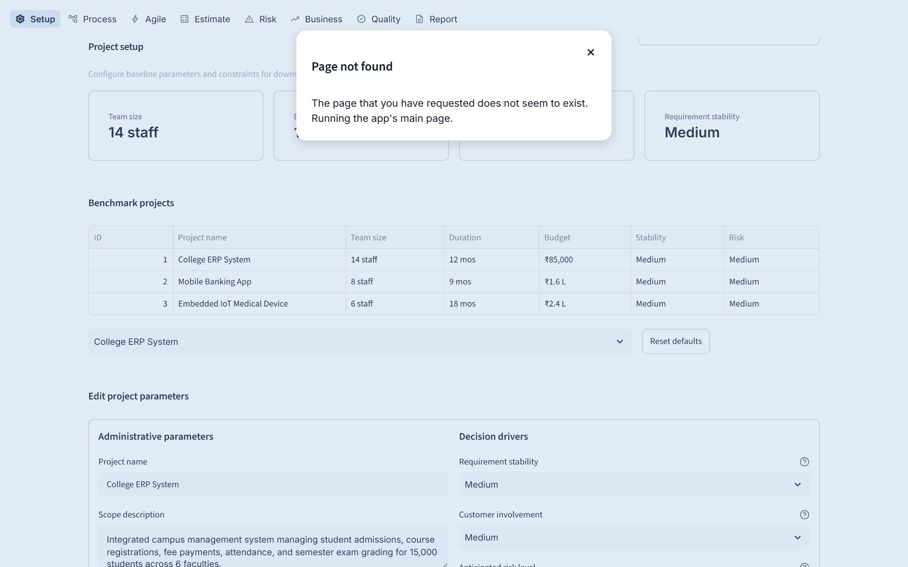

---

### 2. Process (Process Model Advisor)
*Multi-criteria suitability scoring across Waterfall, Spiral, Scrum, XP, and UP with trade-off rationale.*
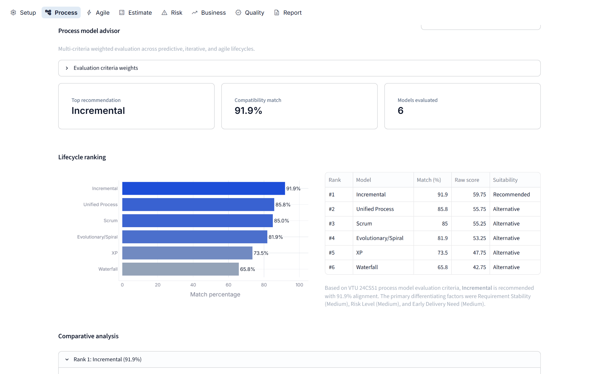

---

### 3. Agile (Agile Lab & Iteration Studio)
*7-framework comparative taxonomy, release velocity burndown, and Beck's flattened cost curve.*
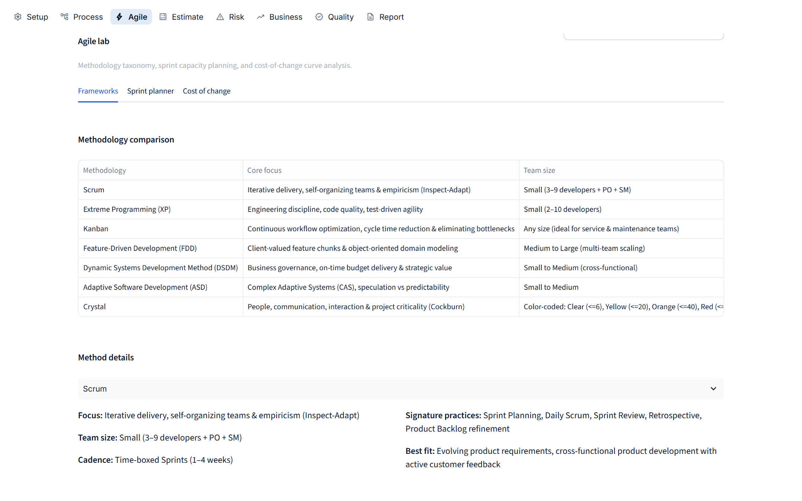

---

### 4. Estimate (Effort & Size Estimator)
*Parametric estimation combining Basic COCOMO, Albrecht FPA, COSMIC FFP, and Bottom-Up PERT.*
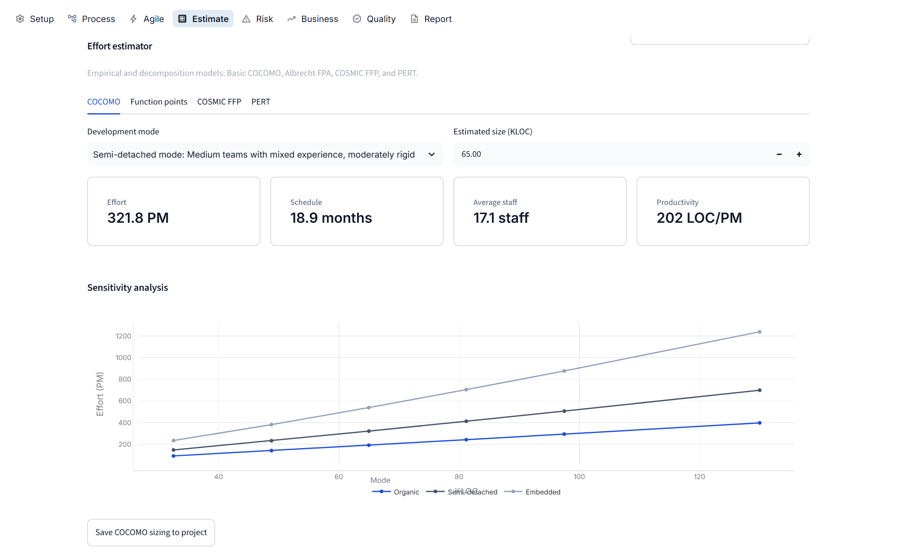

---

### 5. Risk (Risk Register & Exposure Matrix)
*RMMM table logging, Risk Exposure ($RE = P \times I$), and interactive 2D bubble scatter plot.*
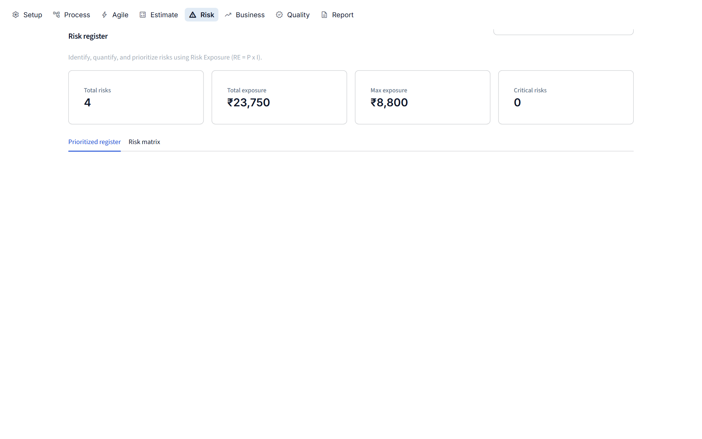

---

### 6. Business (Business Case & Economic Feasibility)
*5-Year cash flow forecasting, Net Present Value (NPV), Scenario EMV, and Risk-Adjusted Discount Rates.*
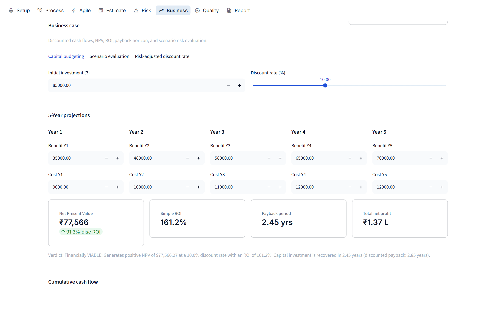

---

### 7. Quality (McCall's Quality Scorecard)
*Audit across 11 McCall quality factors with an interactive polar radar chart.*
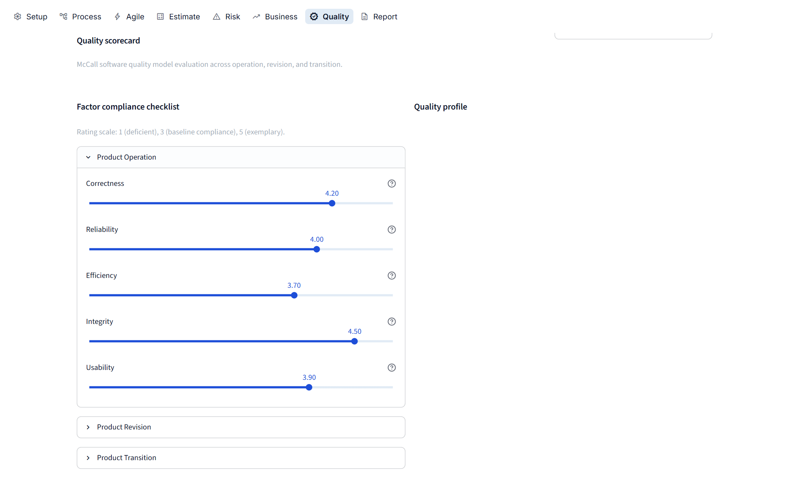

---

### 8. Report (Consolidated Executive Report)
*Cross-module executive synthesis with one-click PDF and CSV download buttons.*
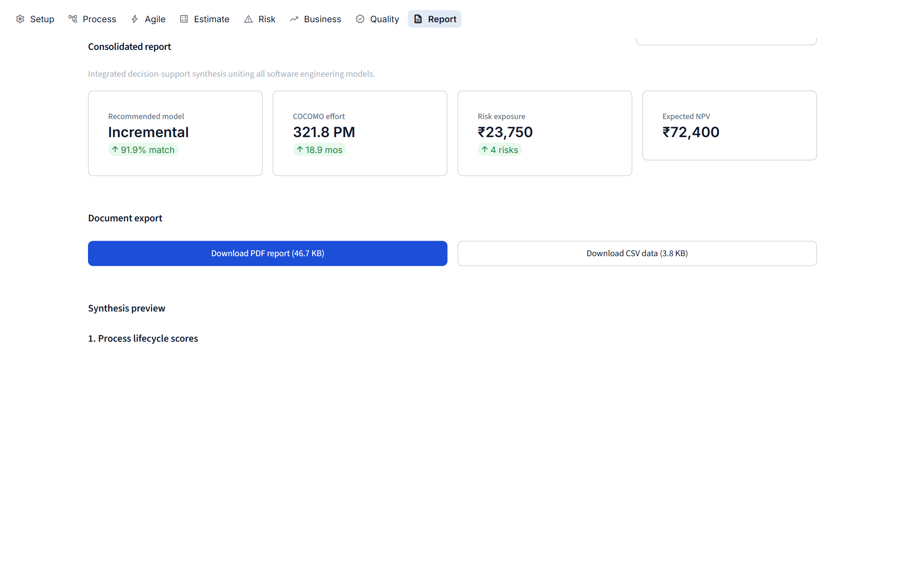

---

### Responsive Layout

ProcessCompass automatically adapts across viewports from 360px mobile displays up to 2560px ultra-wide monitors without horizontal scroll.

<p align="center">
  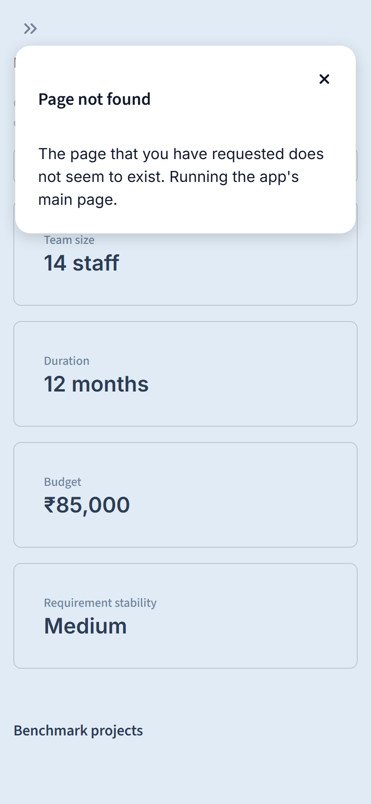
  &nbsp; &nbsp;
  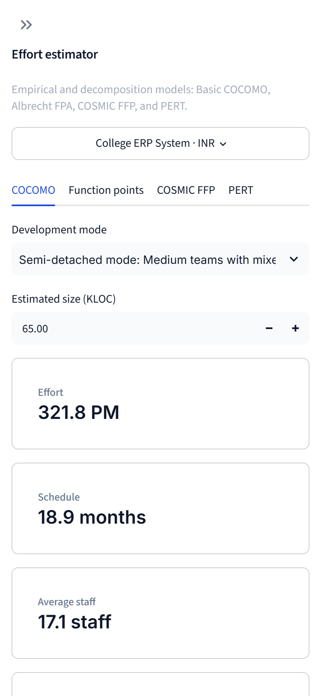
</p>

---

## Assumptions & Limitations

1. **Empirical Model Calibration**:
   - Boehm's Basic COCOMO constants ($a, b, c, d$) are calibrated on historical aerospace and commercial project datasets (1981). Modern software using high-level frameworks, microservices, and AI assistance will typically exhibit higher productivity rates than raw nominal predictions.
2. **Estimates vs Guarantees**:
   - Parametric sizing and PERT intervals represent statistical forecasts based on input parameters. Unplanned scope creep, personnel turnover, or unmitigated risks can induce schedule variance.
3. **Function Point Conversion**:
   - Language gear factors (e.g. 53 LOC/FP for Python, 128 LOC/FP for C) represent industry median benchmarks published by QSM and Capers Jones; actual code density varies by architecture.
4. **Discount Rate Constancy**:
   - Business case calculations assume a uniform annual discount rate and predictable yearly operating costs over the 5-year appraisal horizon.

---

## References

1. **Pressman, Roger S.** *Software Engineering: A Practitioner's Approach*. 7th Edition, McGraw-Hill, 2010. (Prescriptive models, Agile development, SQA, Risk management).
2. **Hughes, Bob, Mike Cotterell, and Rajib Mall.** *Software Project Management*. 6th Edition, McGraw-Hill Education, 2018. (Project evaluation, Cost-benefit, Bottom-up and PERT estimation, Cash flow forecasting).
3. **Boehm, Barry W.** *Software Engineering Economics*. Prentice-Hall, 1981. (COCOMO model formulation, Cost-of-change curve).
4. **Albrecht, Allan J.** "Measuring Application Development Productivity." *Proceedings of the Joint SHARE/GUIDE/IBM Application Development Symposium*, 1979. (Function Point Analysis).
5. **McCall, James A., Paul K. Richards, and Gene F. Walters.** *Factors in Software Quality*. US Rome Air Development Center Reports, 1977. (McCall's Quality Factors taxonomy).
6. **COSMIC Measurement Manual.** *The COSMIC Functional Size Measurement Method*, Version 5.0, Common Software Measurement International Consortium (ISO/IEC 19761), 2020.
7. **Visvesvaraya Technological University (VTU).** *Curriculum and Syllabus for B.E. Computer Science & Engineering (24CS51: Software Engineering & Project Management)*, 2024–2025.

---

## Author

**YUVAN HARSHAJ**  
Department of Computer Science & Engineering  
East Point College of Engineering & Technology, Bangalore  
(Affiliated to Visvesvaraya Technological University - VTU)  
Course: **24CS51 - Software Engineering & Project Management**

---

## License

This project is licensed under the **MIT License** - see the [LICENSE](LICENSE) file for complete details.
