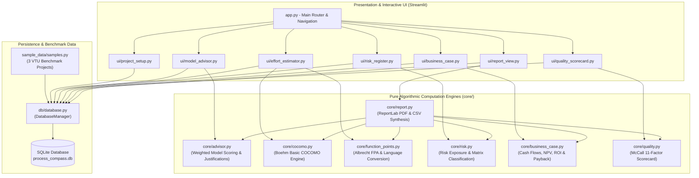

<div align="center">

# 🧭 ProcessCompass

### *A Decision-Support Tool for Selecting a Software Process Model and Estimating Effort, Risk, Cost-Benefit and Quality of a Project*

[](https://www.python.org/)
[](https://streamlit.io/)
[](https://www.sqlite.org/)
[-0A9EDC?style=flat&logo=pytest&logoColor=white)](https://docs.pytest.org/)
[](LICENSE)
[](https://vtu.ac.in/)

</div>

---

## 📖 Overview

**ProcessCompass** is an end-to-end, decision-support software engineering management application aligned with the **VTU 5th Semester Computer Science & Engineering syllabus (24CS51: Software Engineering & Project Management)**.

Software project failures often stem from premature process model selection, unrealistic effort estimation, unquantified risks, or misaligned economic models. **ProcessCompass** bridges academic theory with practical engineering governance. By taking project specifications, team dynamics, and technical constraints, it computes empirical cost estimates (Boehm's COCOMO, Albrecht's FPA), ranks lifecycle methodologies (Waterfall, Spiral, Scrum, XP, UP), quantifies risk exposure ($RE = P \times I$), evaluates capital feasibility (NPV, ROI, Payback), and benchmarks quality posture using McCall's 11-factor taxonomy.

---

## ✨ Key Features

1. **📁 Project Setup & Persistent Workspace**:
   - Multi-project SQLite database with zero-setup initialization.
   - Comprehensive profile management: Team size, duration, budget, requirement volatility, customer involvement, and risk tolerance.
   - 3 preloaded real-world benchmark projects: **College ERP System**, **Mobile Banking App**, and **Embedded IoT Medical Device**.

2. **🏆 Process Model Advisor**:
   - Multi-criteria weighted decision engine scoring **Waterfall, Incremental, Evolutionary/Spiral, Scrum, XP, and Unified Process**.
   - Interactive weight customization matrix with responsive Plotly horizontal bar charts.
   - Plain-English comparative justifications explaining **why the top model won** and the technical friction points **why alternative models scored lower**.

3. **📐 Software Effort & Size Estimator**:
   - **Boehm's Basic COCOMO**: Organic ($2.4 \cdot \text{KLOC}^{1.05}$), Semi-detached ($3.0 \cdot \text{KLOC}^{1.12}$), and Embedded ($3.6 \cdot \text{KLOC}^{1.20}$). Computes Effort (PM), Nominal Schedule (Months), and Average Staffing.
   - **Albrecht's Function Point Analysis (FPA)**: Evaluates 5 Information Domain Elements (EI, EO, EQ, ILF, EIF) across Low/Avg/High complexities and 14 General System Characteristics (GSCs).
   - **FP-to-KLOC Gear Factors**: Automatic conversion across Python, Java, C++, C#, C, JavaScript, TypeScript, SQL, and Assembly.

4. **⚠️ Risk Register & RMMM Exposure Engine**:
   - Standardized Risk Table logging Probability ($P \in [0, 1]$), Impact cost ($I$), and Mitigation action plans.
   - Automatic Risk Exposure computation ($RE = P \times I$) with descending rank prioritization.
   - 2D bubble scatter plot projection and a $3 \times 3$ Likelihood vs Consequence heat map.

5. **💰 Business Case & Economic Feasibility**:
   - Capital budgeting evaluating Discounted Cash Flows (DCF), Net Present Value (NPV), and Simple / Discounted Return on Investment (ROI).
   - Break-even recovery calculation with fractional-year Payback Period interpolation.
   - Multi-trace visual cash flow trajectory with break-even line indicator.

6. **🎯 McCall's Software Quality Scorecard**:
   - 11-factor compliance checklist across **Product Operation** (Correctness, Reliability, Efficiency, Integrity, Usability), **Product Revision** (Maintainability, Flexibility, Testability), and **Product Transition** (Portability, Reusability, Interoperability).
   - Polar radar chart plotting actual quality posture against an industry target baseline.
   - Automated SQA audit verdict and prioritized remediation actions.

7. **📄 Consolidated Executive Synthesis**:
   - Unified cross-module executive dashboard for the selected project.
   - One-click publication-quality **PDF Report Generation** (powered by ReportLab) and raw **CSV Dataset Export**.

---

## 🎓 VTU 24CS51 Syllabus Mapping

| App Page / Feature | VTU 24CS51 Module | Syllabus Topic Covered | Course Outcome |
| :--- | :--- | :--- | :--- |
| **Project Setup** | **Module 1 & 2** | Project Context, Organizational Constraints, Requirements Engineering & Volatility | **CO1** |
| **Process Model Advisor** | **Module 1** | Prescriptive Models (Waterfall, Incremental, Spiral), Unified Process, Agile Development (Scrum, XP) | **CO1** |
| **Effort Estimator (COCOMO)** | **Module 3** | Empirical Estimation Models, Boehm's Basic COCOMO (Organic, Semi-detached, Embedded) | **CO3** |
| **Effort Estimator (FPA)** | **Module 3** | Function-Oriented Metrics, Information Domain Values, 14 GSC Factors, Value Adjustment Factor (VAF) | **CO3** |
| **Risk Register (RMMM)** | **Module 4** | Software Risks, Risk Projection, Risk Table, Risk Exposure ($RE = P \times I$), Mitigation Strategies | **CO4** |
| **Business Case** | **Module 4** | Project Evaluation, Economic Feasibility, Cash Flow Forecasting, NPV, ROI, Payback Period | **CO4** |
| **Quality Scorecard** | **Module 5** | Software Quality Concepts, McCall's Quality Factors (Operation, Revision, Transition), SQA Audit | **CO5** |
| **Consolidated Report** | **Modules 1–5** | Integrated Decision-Support Synthesis, Technical Documentation, Executive Reporting | **CO1–CO5** |

---

## 🏛️ Architecture



---

## 💻 Tech Stack

- **Language**: Python 3.11 / 3.12 / 3.13
- **Frontend / Application Framework**: Streamlit (v1.40+)
- **Interactive Visualizations**: Plotly (v6.0+) & Altair
- **Data Engineering**: Pandas (v2.2+) & NumPy
- **Document Generation**: ReportLab (v4.2+)
- **Embedded Database**: SQLite 3
- **Automated Testing**: pytest (v8.3+)

---

## 📂 Project Structure

```text
SEPM PROJECT/
├── .gitignore                     # Production Git ignore rules
├── LICENSE                        # MIT License
├── README.md                      # Comprehensive academic and engineering manual
├── requirements.txt               # Pinned Python package dependencies
├── app.py                         # Application entrypoint & sidebar router
│
├── core/                          # Pure calculation engines (zero UI dependencies)
│   ├── __init__.py
│   ├── advisor.py                 # Multi-criteria lifecycle scoring & justifications
│   ├── cocomo.py                  # Basic COCOMO formulas & empirical modes
│   ├── function_points.py         # Albrecht's FPA (UFP, TDI, VAF, AFP) & language gears
│   ├── risk.py                    # Risk Table, Exposure (P x I), and 2D matrix
│   ├── business_case.py           # Discounted cash flows, NPV, ROI, and Payback
│   ├── quality.py                 # McCall's 11 Quality Factors & SQA assessment
│   └── report.py                  # ReportLab PDF & CSV consolidated export engines
│
├── db/                            # SQLite Persistence Layer
│   ├── __init__.py
│   └── database.py                # DatabaseManager with schema DDL & cascade queries
│
├── sample_data/                   # Curated VTU benchmark reference projects
│   ├── __init__.py
│   └── samples.py                 # College ERP, Mobile Banking App, Embedded IoT Device
│
├── ui/                            # Streamlit page view controllers & styling
│   ├── __init__.py
│   ├── components.py              # Shared CSS, session management & syllabus badges
│   ├── project_setup.py           # Project CRUD & parameter configuration
│   ├── model_advisor.py           # Lifecycle recommendation view & config weights
│   ├── effort_estimator.py        # COCOMO & FPA calculators with language bridging
│   ├── risk_register.py           # RMMM table, heat map, and exposure tracker
│   ├── business_case.py           # Financial tables, DCF curves, and break-even charts
│   ├── quality_scorecard.py       # McCall taxonomy checklist & polar radar chart
│   └── report_view.py             # Consolidated summary view & download triggers
│
├── docs/                          # Project documentation & graphical assets
│   └── screenshots/               # High-resolution application screenshots
│       ├── 01_project_setup.png
│       ├── 02_model_advisor.png
│       ├── 03_effort_estimator.png
│       ├── 04_risk_register.png
│       ├── 05_business_case.png
│       ├── 06_quality_scorecard.png
│       └── 07_consolidated_report.png
│
└── tests/                         # Automated test suite (28 unit tests)
    ├── test_advisor.py
    ├── test_business_case.py
    ├── test_cocomo.py
    ├── test_db.py
    ├── test_function_points.py
    ├── test_quality.py
    ├── test_report.py
    └── test_risk.py
```

---

## 🧮 Mathematical Formulas & Principles Used

### 1. Boehm's Basic COCOMO (Module 3)
$$\text{Effort} = a \cdot (\text{KLOC})^b \quad [\text{Person-Months (PM)}]$$
$$\text{Development Time} = c \cdot (\text{Effort})^d \quad [\text{Nominal Months}]$$
$$\text{Average Staff Size} = \frac{\text{Effort}}{\text{Development Time}} \quad [\text{Engineers}]$$
$$\text{Productivity} = \frac{\text{KLOC} \times 1000}{\text{Effort}} \quad [\text{LOC / PM}]$$

| Software Mode | $a$ | $b$ | $c$ | $d$ | Characteristic Domain |
| :--- | :---: | :---: | :---: | :---: | :--- |
| **Organic** | 2.4 | 1.05 | 2.5 | 0.38 | Small teams, familiar environment, stable requirements |
| **Semi-Detached**| 3.0 | 1.12 | 2.5 | 0.35 | Medium teams, mixed experience, intermediate constraints |
| **Embedded** | 3.6 | 1.20 | 2.5 | 0.32 | Strict hardware interfaces, flight/medical/safety constraints |

---

### 2. Albrecht's Function Point Analysis (Module 3)
$$\text{UFP} = \sum_{i=1}^{5} \sum_{j=1}^{3} (\text{Count}_{i,j} \times W_{i,j})$$
$$\text{TDI} = \sum_{k=1}^{14} F_k \quad (0 \le F_k \le 5)$$
$$\text{VAF} = 0.65 + (0.01 \times \text{TDI}) \quad \implies 0.65 \le \text{VAF} \le 1.35$$
$$\text{AFP} = \text{UFP} \times \text{VAF}$$
$$\text{Equivalent KLOC} = \frac{\text{AFP} \times \text{LOC\_Factor}_{\text{Language}}}{1000}$$

---

### 3. Software Risk Exposure & Prioritization (Module 4)
$$\text{Risk Exposure (RE)} = \text{Probability } (P) \times \text{Impact Cost } (I)$$
$$\text{Total Project Exposure} = \sum_{i=1}^{N} \text{RE}_i$$

---

### 4. Economic Feasibility & Cost-Benefit (Module 4)
$$\text{Discount Factor at Year } t = \frac{1}{(1 + r)^t}$$
$$\text{Net Present Value (NPV)} = -C_0 + \sum_{t=1}^{N} \frac{B_t - O_t}{(1 + r)^t}$$
$$\text{Simple ROI (\%)} = \left( \frac{\sum_{t=1}^{N} (B_t - O_t) - C_0}{C_0} \right) \times 100$$
$$\text{Payback Period} = \text{Year}_{t-1} + \left( \frac{\text{Cumulative Deficit}_{t-1}}{\text{Net Inflow}_t} \right)$$
*(where $C_0$ = Initial Capital Investment, $B_t$ = Benefit in Year $t$, $O_t$ = Operating Cost in Year $t$, $r$ = Discount Rate).*

---

### 5. McCall's Software Quality Model (Module 5)
$$\text{MQI} = \frac{1}{11} \sum_{k=1}^{11} \text{Rating}_k \quad (1.0 \le \text{Rating}_k \le 5.0)$$
- **Product Operation (5 Factors)**: Correctness, Reliability, Efficiency, Integrity, Usability.
- **Product Revision (3 Factors)**: Maintainability, Flexibility, Testability.
- **Product Transition (3 Factors)**: Portability, Reusability, Interoperability.

---

## 🚀 Installation & Setup

### Prerequisites
- Python 3.11 or higher installed.
- Git installed.

### 1. Clone the Repository
```bash
git clone https://github.com/yuvanharshaj/SEPM-PROJECT.git
cd SEPM-PROJECT
```

### 2. Create and Activate Virtual Environment
```bash
# Windows (PowerShell)
python -m venv venv
.\venv\Scripts\Activate.ps1

# Linux / macOS
python3 -m venv venv
source venv/bin/activate
```

### 3. Install Dependencies
```bash
pip install -r requirements.txt
```

---

## 🏃 Running the Application

Launch the Streamlit web application:
```bash
streamlit run app.py
```
Open your web browser and navigate to `http://localhost:8501`.

---

## 🧪 Running the Unit Tests

The test suite validates every empirical formula, boundary condition, and database transaction:

```bash
python -m pytest tests/ -v
```

### Test Coverage Summary:
- `test_cocomo.py`: Mathematical precision of Boehm equations, mode constants, invalid input exceptions.
- `test_function_points.py`: UFP summation, VAF boundary clamping ($0.65$ to $1.35$), language gear factors.
- `test_advisor.py`: Scoring matrices, agile vs predictive preference validation, custom weight tuning.
- `test_risk.py`: $RE = P \times I$ calculation, exposure ranking, empty list safety.
- `test_business_case.py`: Cash flow discounting, NPV, ROI, and linear payback interpolation.
- `test_quality.py`: McCall's 11-factor taxonomy, pillar averages, MQI score calculation.
- `test_db.py`: SQLite DDL execution, sample preloading, CRUD transactions, cascade deletion.
- `test_report.py`: Automated ReportLab PDF compilation and CSV formatting.

---

## 📸 Screenshots

### 1. Project Setup & Workspace Configuration
*Manage project constraints, team size, volatility, and switch between sample benchmarks.*


---

### 2. Software Process Model Advisor
*Weighted evaluation across Waterfall, Spiral, Scrum, XP, and UP with plain-English trade-off justifications.*


---

### 3. Software Effort & Size Estimator
*Boehm's Basic COCOMO formulas, multi-mode sensitivity curves, Albrecht FPA, and language gear factors.*


---

### 4. Software Risk Register & Heat Map
*Risk Table logging, quantitative Risk Exposure ($RE = P \times I$), and interactive 2D bubble scatter projection.*


---

### 5. Business Case & Economic Feasibility
*5-Year cash flow forecasting, Net Present Value (NPV), ROI, and break-even recovery chart.*


---

### 6. McCall's Software Quality Scorecard
*Audit across 11 quality factors with an interactive polar radar chart comparing against target benchmarks.*


---

### 7. Consolidated Executive Report & Export
*Cross-module executive synthesis with one-click PDF and CSV download buttons.*


---

## 🔮 Future Scope

- **COCOMO II Extension**: Incorporate Early Design and Post-Architecture models with 17 Effort Multipliers (EMs) and 5 Scale Factors (SFs).
- **Automated Repository Analytics**: Direct Git repository integration to extract physical KLOC and commit churn metrics automatically.
- **Monte Carlo Simulation**: Probabilistic risk simulation for schedule variance and budget contingencies.
- **Multi-Tenant Cloud Sync**: Support for PostgreSQL and role-based access control (RBAC) for distributed engineering teams.

---

## 👤 Author

**YUVAN HARSHAJ**  
Department of Computer Science & Engineering  
Visvesvaraya Technological University (VTU)  
Course: **24CS51 - Software Engineering & Project Management**

---

## 📄 License

This project is licensed under the **MIT License** - see the [LICENSE](LICENSE) file for complete details.

